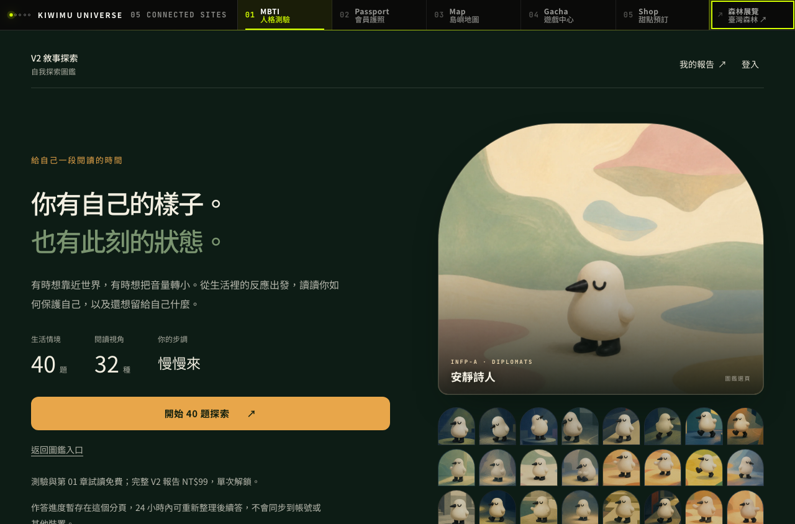
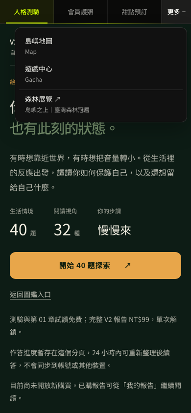

# 森林展覽入口與手機導覽收斂

2026-10-12，MBTI repo 候選版本；尚未合併／正式部署。

## 行為

- 桌機沿用黑底／lime 五站導覽，在 Shop 後加入「森林展覽」，連到 https://canopy.kiwimu.com/ ，另開分頁。
- 手機 640px 以下保留「人格測驗／會員護照／甜點預訂／更多」；更多內有地圖、遊戲、森林展覽。
- 更多支援 Tab、Escape 回到按鈕、點外部／焦點離開／視窗尺寸改變時收起；短視窗與放大文字依頂欄實際高度提供可捲動空間。
- 五站原有導航來源參數、登入狀態與分析事件欄位保持；展覽不冒充第六個會員服務，不加入原五站事件列舉。
- 只修改 kiwimu.com；其他站選單沒有隨本 PR 改版。

## 作者驗證

- typecheck、正式 build 通過（既有 bundle 大小警告保留）。
- 55 個單元測試檔、645 項測試通過。
- 12 項 PWA navigation matcher 通過。
- 20 組鍵盤與文字 200% 回歸通過，涵蓋 V1／V1.5／V2 及報告章節。
- 固定 production build 的 26 組導航案例通過：6 路由 × 320／390／768／1280 共 24 組，加 320／390 的文字 200% 與 resize。
- 六路由：首頁、V1.5、V2 圖鑑、V2 測驗、我的報告、ESTJ-A 報告。外部請求封鎖、API 使用本機 fixtures，正式寫入為 0。
- 檢查實際展開／收起、焦點、觸控區至少 44px、href／新分頁、水平溢出、桌機 sticky、選單覆蓋層及 pageerror。
- 人工開圖核對以下實際頁面截圖；不是以 Loading 畫面代表通過。

## 範圍與限制

Chromium 本機測試不代表真人 iPhone Safari／LINE／VoiceOver 簽收，也不代表正式登入、付款或通知驗收。測試攔截外站請求會有預期的 console 網路錯誤，故沒有宣稱全部 console 為零。

截圖的「目前尚未開放新購買」來自本機 build 的 checkout 設定；此 PR 不修改正式結帳設定、NT$99、API、資料庫、題目或計分。

## 實際截圖

桌機 1280×844；森林展覽的亮框是鍵盤焦點。

手機 390×844；更多展開。

