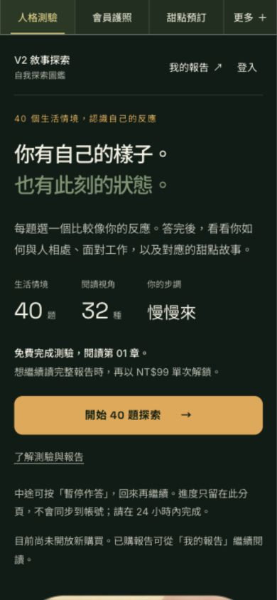
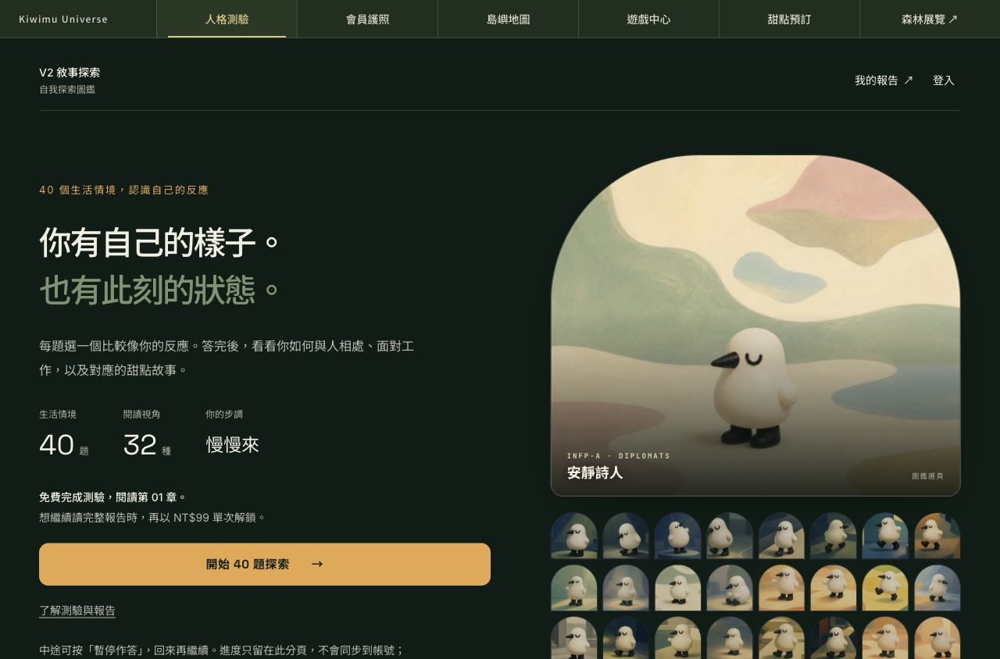
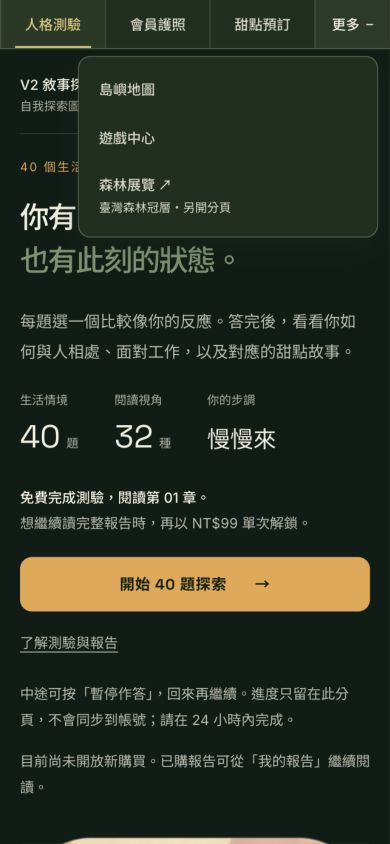

# MBTI 月島共同導覽候選｜2026-10-13

Penso 要求全部上方 bar 統一；以已上線的 Passport 深綠導覽為基準。

## 改動

深綠 `#1F2F1F`、奶油白 `#F5F0E8`、柔金 `#D7C678`。中文入口 14px、操作區 48px。桌機保留五站與森林展覽；手機顯示人格測驗／會員護照／甜點預訂，其餘放在「更多」。支援 Escape、點外部、離開焦點與切回桌機時收合。

保留 `mbti_universe_nav`、props／auth effect／tracking 與 capture Escape。安全區留白與展開狀態 z-index 210 均保留。五個凍結檔案、題庫／計分／付費程式無 diff。

## 驗證

`npm run typecheck`、`npm test`（55 files／645 tests）、`npm run build` 全部通過。

作者內建瀏覽器 13 案：320／390／768／1280px 與本專案公開頁，水平溢出 0，導覽顏色、字級與 ≥44px 操作區通過；「更多」與 Escape 正常。另驗 320×240 下森林連結鍵盤焦點與 hit test。選單層級亦以程式碼核對，未宣稱這張短視窗截圖含已掛載的章節導覽。

獨立程式覆核 APPROVE；runtime diff SHA256：`1791242deeb8bd8925108d29bedb7665781cf28d48f4a47b5cffc2d0184612e8`。作者瀏覽器 QA 不等於獨立視覺或真人簽收。

## 狀態與限制

**狀態更新（2026-10-14）：已於 2026-10-13 以 PR #50 合併上線**，五站共用森林版 rail 已同步。
以下「候選」字樣與限制為合併前的原始紀錄，保留作歷史依據。

候選尚未合併、未部署 production；須 Penso 批准（以上已被 PR #50 合併取代）。不是五站完整內容驗收；未真人 Safari／LINE／VoiceOver、登入、交易、抽獎、點數／核銷或通知送達驗收。QA 過程隔離 API 與分析。

本機：[候選預覽](http://127.0.0.1:5255/read/quiz)

## 畫面

## CI 發現後的追加驗證

更多文字與全形加號允許自然換行，保留 48px 最小高度與焦點機制。最終五站20尺寸案與各站390px開／關10案均通過；原多路由36案是追加前的證據。MBTI額外20 accessibility／44 V2／110 report-reading／4生成器通過，不擴張成其他站真人流程驗收。完整桌機截圖以明確1280×844 clip重拍，避免內建瀏覽器面板裁切。
