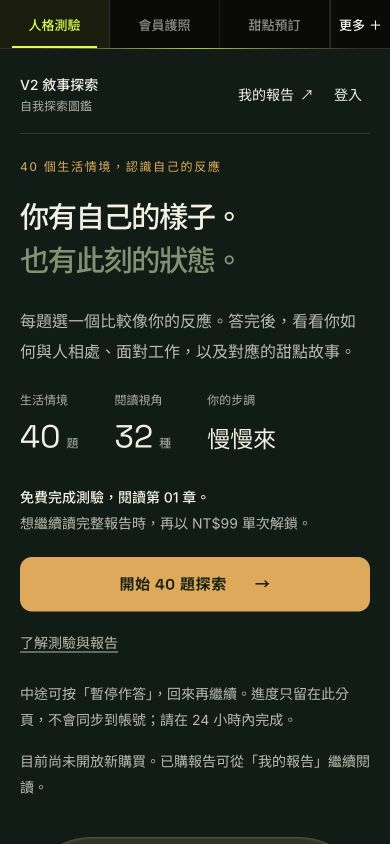
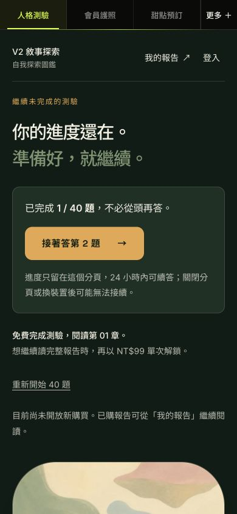
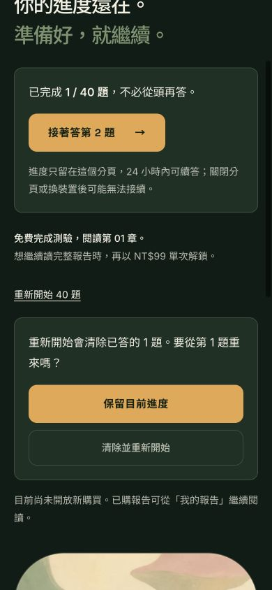

# V2 直覺操作候選（2026-10-12）

在開始前說清免費／NT$99；有草稿先續答；暫停留在原頁、不重載；重新開始先確認，預設保留進度。沿用 Quiet Atlas。

## 作者驗證

- typecheck、正式 build、645 單元測試通過。
- 20 鍵盤／文字 200% 檢查、44 V2 隔離流程通過。44 包含 5 個新增操作情境、4 個完整 40 題流程與 35 個照片情境。
- 新增 mobile／desktop／landscape／320 文字 200%／draft setItem 失敗：檢查暫停不 reload、續答題號、換題停用、焦點、取消與 Escape 保留、明確重開、未完成不通知。
- 內建瀏覽器 390 與 1280 實走一題、暫停、展開重開、Escape 取消。以下是本輪真實候選截圖；不是 mockup。
- 所有自動流程僅本機，權益與菜單為 fixture，正式外部寫入 0。沒有真人 Safari／LINE／VoiceOver、登入／付款／通知送達驗收。
- 本機未啟用 checkout，因此截圖的「尚未開放」不代表正式站設定。

## 截圖

## 獨立覆核

`/root/review_intuitive_quiz_20261012` 唯讀覆核 7 檔產品／測試 diff，APPROVE、無必修；自行 31 個相關單元通過。
覆核 diff SHA256：`086d9e94ecc6da5c2eff55dc59f603610f185378d761abb7343122d71b9c5140`。其後只補本文件與三張截圖。
LOW optional：browser fixture 只阻擋草稿寫入，不應稱為所有 storage API 全禁用的 UI 驗收；未擴張此宣稱。

未合併、未部署；新 PR 上線需 Penso 另行批准。
