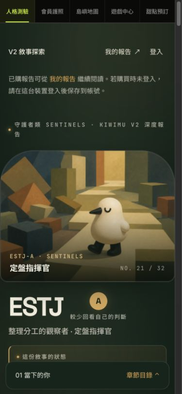

# V2 完整報告閱讀升級

公開圖片只含第一章封面；完整付費章節截圖留在本機驗收證據，不上傳公開 CI artifact。

瀏覽器要求 390px 模擬；本截圖 API 實際回傳 375×812 JPEG，以實際格式命名。320／390／768／1280 的驗證尺寸以 Playwright 視窗與 DOM 斷言為準。

## 本機驗證

- TypeScript 檢查通過；55 檔／645 單元測試通過。
- 生成器 4 案：引用段落、多段標籤、敘事第二段、absolute symlink CLI。
- 固定 production 建置的 110 報告案通過：32 變體 × 320／390／1280；四家族 768／文字 200%；兩個鎖定案。
- 固定建置的 39 V2 案通過：四種視窗完成 40 題、照片載入失敗／重試、無照片／品項對應。
- 後續 Linux CI 執行同一套檢查，另含鍵盤／文字放大、四組 build 與 PWA 更新。

## 範圍與限制

文案從既有 Obsidian 正本生成，涵蓋 32 份報告與 128 個情境例子；保留原創第一人稱金句與甜點敘事。正文 16px、重要說明 14px、標註 12px；手機 A／T 上下排列，工作／關係單欄。

這是 loopback 預覽：付費權益、菜單與通知使用 fixtures；預覽封面的解鎖提示不代表真人付款。未執行正式登入、付款、寄信、Discord 或資料庫寫入。尚未真人 iPhone Safari／LINE／VoiceOver 驗收，不宣稱完整 WCAG 認證。題庫、計分、價格、付款權益與通知維持既有程式。

新 PR 未合併、未正式部署。獨立覆核的最終狀態以 PR 說明與交付報告為準。
